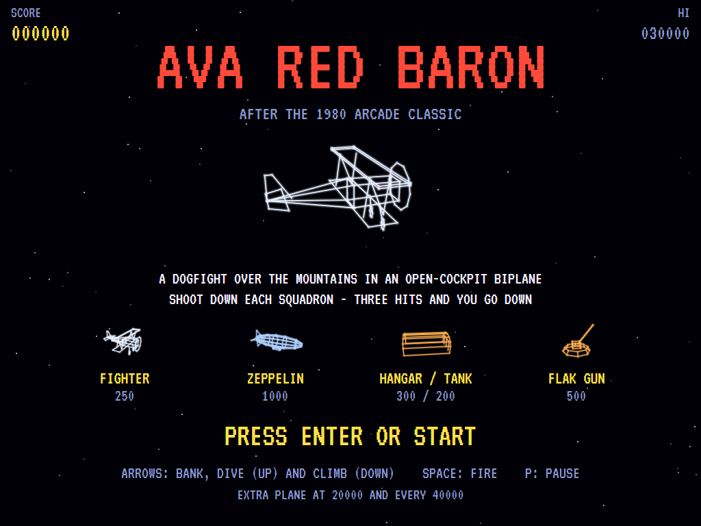
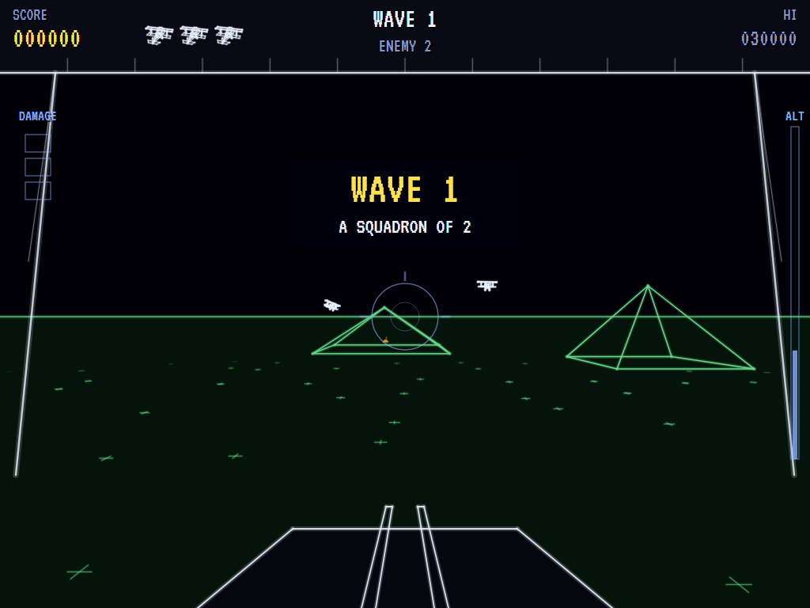
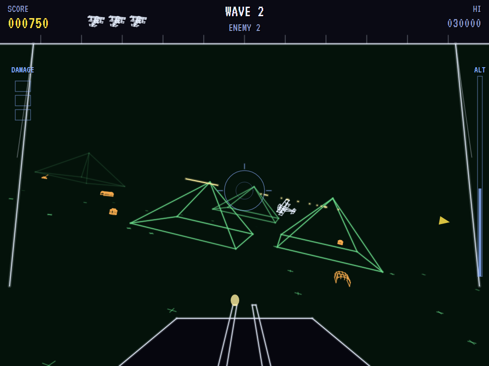
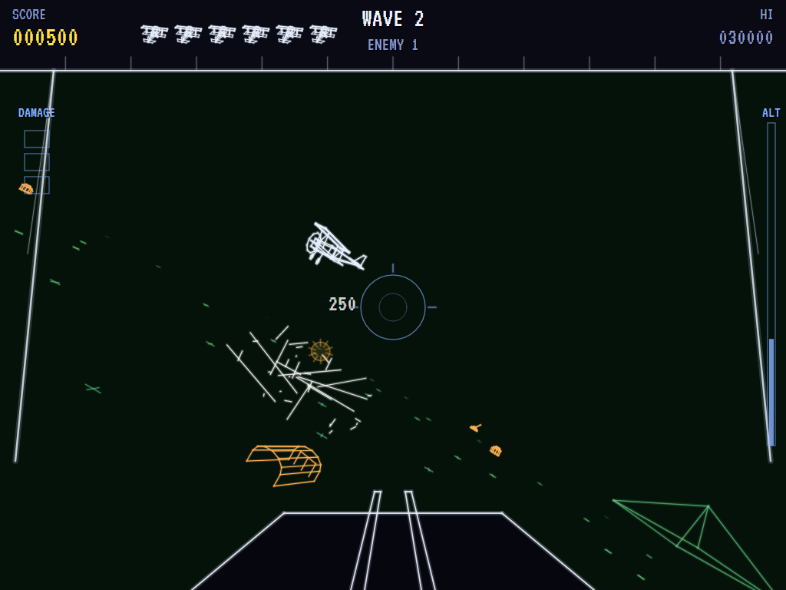
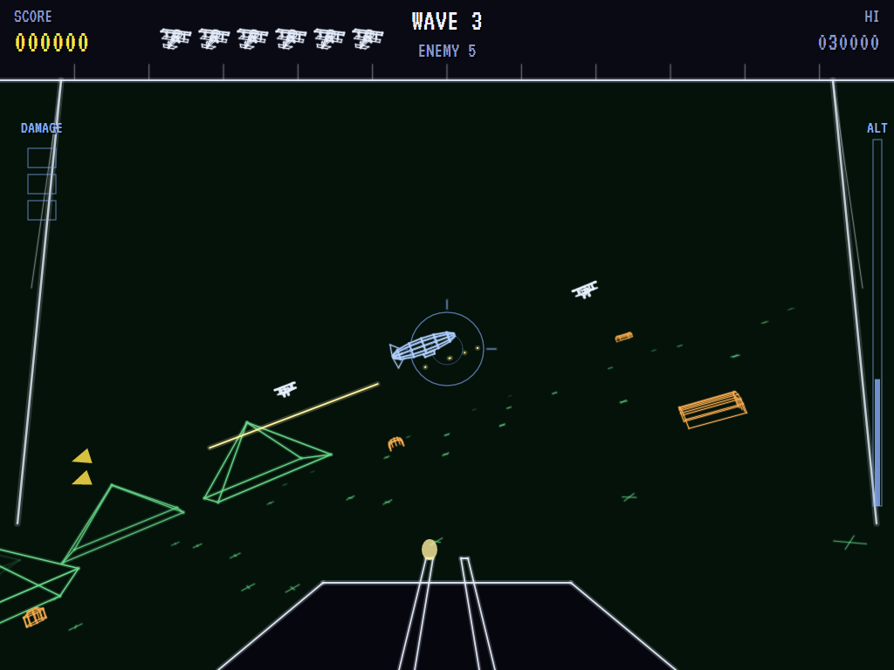
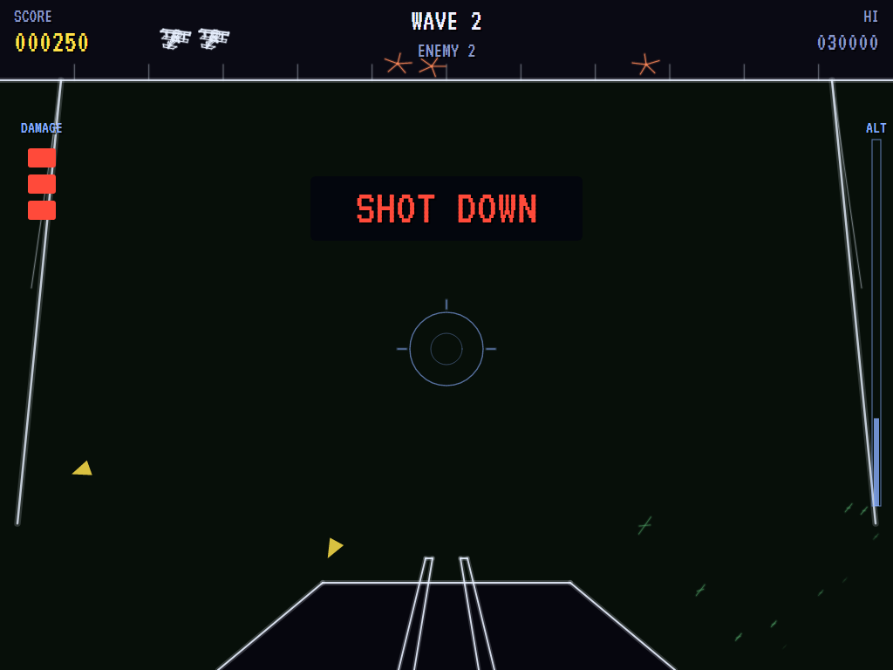
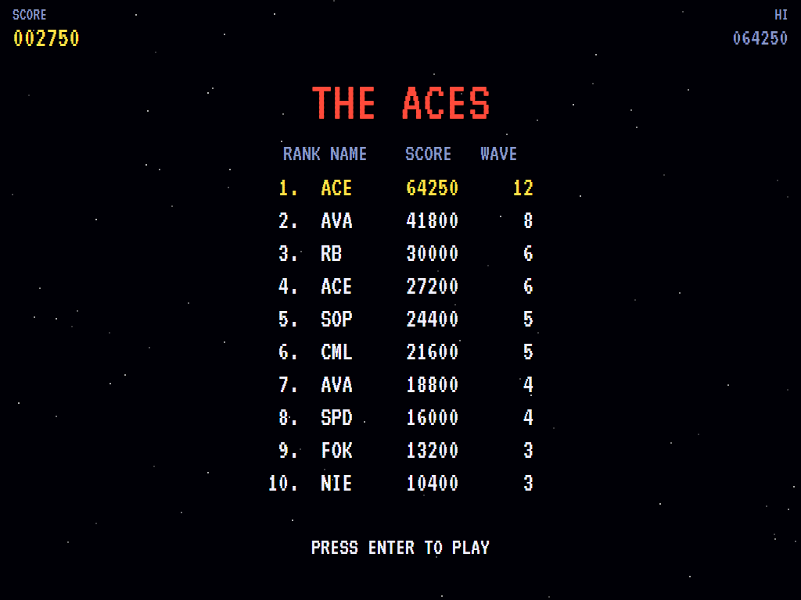

# AVA Red Baron

[](https://github.com/Harlock123/AVARedBaron/actions/workflows/build.yml)

A first-person biplane dogfight in the style of Atari's 1980 vector arcade game **Red Baron**, built with
.NET 10 and Avalonia UI. From the open cockpit, drawn in glowing vector lines, bank, climb and dive after
squadron after squadron of enemy fighters over a countryside of mountains. Shoot down zeppelins, and
strafe the hangars, fuel tanks and flak guns on the ground. Three hits bring you down.

## Features

- **Flying**:
  - **The controls:** bank left and right to turn, and the horizon tilts as you do. Push the stick forward to dive and pull back to climb. You always fly at full speed, and there's a ceiling.
  - **Crashing:** fly into the ground or a mountainside and you crash. The altimeter turns red and a **PULL UP!** warning sounds when you're low.
  - **The world:** the countryside wraps round, so you can fly for ever.
- **The cockpit**:
  - **The view:** the underside of the upper wing across the top, the struts, the cowling, and the twin machine guns with their muzzle flash.
  - **Aiming:** a ring sight in the middle.
  - **Damage:** a gauge on the left, and bullet holes appear in the wing as you're hit.
  - **Arrows** round the edge of the view point to enemies out of sight. Red ones are attacking you.
- **The enemy**:
  - **Fighters** circle at a distance, then break off a few at a time to come at you. They lead their aim, fire bursts when they're lined up, pass just over you, and break away to come round again.
  - **Zeppelins** come with every third wave. They're huge and slow, take eight hits, and are worth 1,000.
  - **Hangars, fuel tanks and flak guns** dot the plains. Dive and strafe them for points.
  - **Flak:** the guns throw bursts at where you're going to be whenever you fly near them below the flak ceiling.
- **Waves**: each squadron is bigger and keener than the last. Shoot every plane (and zeppelin) down to clear the wave and have your plane patched up.
- **Damage**: a bullet or a close flak burst is one hit, and the third brings you down. Your next plane starts high over open country, with the enemy pulled back to circling.
- **Scoring**:

  | | Points |
  |---|---|
  | Fighter | 250 |
  | Zeppelin | 1,000 |
  | Hangar | 300 |
  | Fuel tank | 200 |
  | Flak gun | 500 |

  - **Extra planes** come at 20,000 and every 40,000 after that.
- **Sound**:
  - **The title tune:** an original flying-corps march.
  - **The effects:** the rotary engine's putter, the guns' rattle, flak bursts, hits, planes going down and zeppelins going up in flames, and the low-level warning.
  - All of it is synthesised and mixed by OpenAL.
- **Attract mode**: leave the title alone for 15 seconds and a computer pilot flies. It keeps clear of the ground and the mountains, ducks under fighters coming straight at it, and leads its targets.
- **A top-ten high-score table** with arcade-style initials entry. It records the wave reached.
- **Gamepads** through SDL2, as well as the keyboard.
- **Any window size**: the screen scales to fit, letterboxed. **Ctrl+S** saves a screenshot.
- **One self-contained executable** per platform: Windows, macOS and Linux on Intel/AMD and ARM.

## Screenshots

| The title | A squadron comes | Dogfight |
|:---------:|:----------------:|:--------:|
|  |  |  |
| What everything is worth. | Wave 1. | Lined up in the ring sight. |

| Banking | A zeppelin | Shot down |
|:-------:|:----------:|:---------:|
|  |  |  |
| The world tilts as you turn. | Slow, huge, and worth 1,000. | Three hits on the gauge. |

| The aces | | |
|:--------:|:-:|:-:|
|  | | |
| The high-score table. | | |

The screenshots are made by the tests, which play the game in a real (headless) window; see
[Tests](#tests).

## Download and run

Ready-to-run builds for Windows, macOS and Linux, on both Intel/AMD and ARM, are on the
[Releases page](https://github.com/Harlock123/AVARedBaron/releases/tag/latest). **Latest build** is
rebuilt on every push to `main`. Each download is one self-contained executable: no .NET install is
needed.

| Platform | Archive |
|---|---|
| Windows | `AVARedBaron-win-x64.zip`, `AVARedBaron-win-x86.zip`, `AVARedBaron-win-arm64.zip` |
| macOS | `AVARedBaron-osx-arm64.tar.gz` (Apple silicon), `AVARedBaron-osx-x64.tar.gz` (Intel) |
| Linux | `AVARedBaron-linux-x64.tar.gz`, `AVARedBaron-linux-arm64.tar.gz`, `AVARedBaron-linux-arm.tar.gz` |

```bash
tar -xzf AVARedBaron-linux-x64.tar.gz     # or linux-arm64, linux-arm, osx-arm64, osx-x64
./AVARedBaron
```

On Windows, unzip and run `AVARedBaron.exe`. On macOS, if Gatekeeper refuses to open it, run
`xattr -d com.apple.quarantine AVARedBaron` once. Run with `--no-audio` for silence.

**Sound** comes through OpenAL Soft, built in for every platform. In a virtual machine the game
detects it and uses a larger audio buffer, so the sound doesn't break up.

**Gamepads** use SDL2, which is bundled for Windows, macOS and Intel/AMD Linux. ARM Linux builds need it
installed; without it the keyboard still works:

```bash
sudo apt install libsdl2-dev            # Debian / Ubuntu / Raspberry Pi OS
sudo pacman -S --needed sdl2-compat     # Arch / Omarchy
```

## Controls

| Input | Action |
|-------|--------|
| **Enter** | Start |
| **Left** / **Right** (or **A** / **D**) | Bank and turn |
| **Up** / **W** | Dive (push the stick forward) |
| **Down** / **S** | Climb (pull the stick back) |
| **Space** / **Z** / **X** / **Ctrl** | Fire (hold to keep firing) |
| **P** / **Esc** | Pause (Esc again to quit) |
| **M** | Mute |
| **Ctrl+S** / **Cmd+S** | Save a screenshot to the Pictures folder |

**Gamepad**: left stick or D-pad to fly (forward dives, back climbs), **A**, **B** or **X** to fire,
**Start** to start and pause, **Back** (while paused) to quit.

**Entering initials**: type letters, or dial with **Up**/**Down** and accept with **Space**; **Left** /
**Backspace** go back; **Enter** finishes.

## Tests

```bash
dotnet test AVARedBaron.slnx
```

The engine has no UI and runs in fixed 60 Hz steps, so it plays the same at any frame rate, and a seed
always plays the same game. The tests check:

- **Flying:**
  - full speed
  - banking to turn, with the view tilting
  - diving and climbing, and the ceiling
  - crashing into the ground or a mountain, with the warning first
  - the world wrapping round
- **Shooting:**
  - the twin guns firing in turn
  - fighters, and zeppelins that take many hits
  - strafing ground targets
- **The enemy:**
  - fighters circling, then attacking a few at a time
  - their fire
  - three hits bringing you down
  - flak that only reaches low flyers and hurts when it bursts close
  - collisions
- **Waves and lives:**
  - bigger squadrons, and zeppelins every third wave
  - repairs between waves
  - the next plane high over open country with the enemy pulled back
  - the last plane and initials
  - extra planes
- **The machine:** the world's mountains and targets, the attract cycle, the computer pilot clearing the first squadrons, the same game from the same seed, and pausing

The screenshot tests draw the real screen in a headless window. To refresh the README's pictures:

```bash
BARON_SHOTS=$PWD/Images dotnet test tests/AVARedBaron.Tests --filter ScreenshotTests
```

To see how the computer pilot gets on, wave by wave (for tuning), or how a player who flies straight and
level with the trigger held does (`BARON_PROBE=lazy`):

```bash
BARON_PROBE=1 dotnet test tests/AVARedBaron.Tests --filter PilotProbe --logger "console;verbosity=detailed"
```

## Building

```bash
dotnet build AVARedBaron.slnx
dotnet run --project src/AVARedBaron
```

Needs the .NET 10 SDK. The sounds are made by `tools/make_sounds.py` (standard-library Python):
`python3 tools/make_sounds.py` rewrites `src/AVARedBaron/Sounds`.

## Project structure

```
AVARedBaron/
├── AVARedBaron.slnx
├── src/AVARedBaron/
│   ├── Engine/
│   │   ├── GameEngine.cs        # States, the title and demo cycle, and the engine's drone
│   │   ├── GameEngine.Play.cs   # Flying, the guns, the enemy squadrons and zeppelins, flak,
│   │   │                        # crashes, damage, waves and scoring
│   │   ├── ShipPilot.cs         # The computer pilot, for the demonstration (and the tests)
│   │   ├── Entities.cs          # The wrapping countryside, the cockpit camera, planes, targets,
│   │   │                        # mountains, tracers, flak and wreckage
│   │   ├── Wireframe.cs         # The vector models: biplane, zeppelin, hangar, fuel tank, flak gun
│   │   ├── Vec3.cs              # 3D points and turns
│   │   ├── HighScoreTable.cs, InitialsEntry.cs
│   │   ├── InputHandler.cs, ControllerManager.cs  # Keys and an SDL2 gamepad
│   │   └── SoundManager.cs      # Effects and the tunes through OpenAL
│   ├── Audio/                   # The OpenAL engine (from the author's AVABand)
│   ├── Views/                   # The horizon, the ground and mountains, the models, the cockpit and
│   │                            # its instruments, the screens
│   └── Sounds/                  # The synthesised effects and tunes
├── tests/AVARedBaron.Tests/     # Gameplay, screenshot and probe tests
├── tools/make_sounds.py
└── Images/                      # Screenshots
```

## About and licence

AVA Red Baron © 2026 Lonnie Watson, under the [MIT License](LICENSE).

*Red Baron* © 1980 Atari; the name belongs to its current owner. AVA Red Baron is an independent,
unofficial game in its style. Its planes, zeppelins, countryside, cockpit, graphics, sounds, tunes and
code are its own; nothing is taken from the arcade machine's program, graphics, sound or music. It is not
affiliated with or endorsed by any rights holder.
